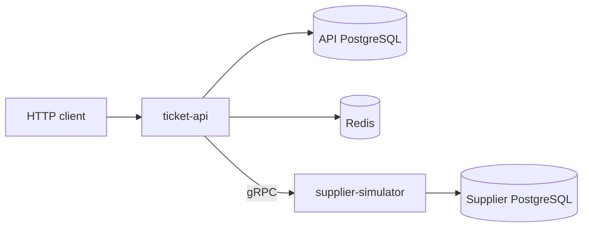

# Architecture

## System Overview

Ticket Aggregator API consists of two processes:

1. `ticket-api` — the public HTTP API, aggregator business logic, primary PostgreSQL database, and Redis.
2. `supplier-simulator` — an internal gRPC service that simulates supplier search and refunds and stores a minimal refund execution log in a separate PostgreSQL database.

The API is a modular monolith: domains are assembled in `cmd/api/main.go` and communicate through small interfaces defined in `contracts.go`. The supplier simulator runs as a separate process because it represents an external integration with independent state and network failures.

## Domain Layers

Most domains follow the same structure:

- `handlers` parse HTTP requests, get user information from the request context or cookies, and build responses.
- `service` coordinates user flows and makes business decisions.
- `repository` executes SQL and atomic storage operations.
- `contracts.go` defines dependencies through interfaces.
- Package-level files contain DTOs, models, statuses, rules, and domain errors.

The repository may execute a database transaction, while the service decides the sequence of actions and transition conditions. This separation matters most for payment and refunds.

## Domains

| Domain | Responsibility | Main dependencies |
| --- | --- | --- |
| `auth` | registration, login, JWTs, refresh rotation, logout, password recovery | PostgreSQL, Redis, mailer |
| `users` | account owner profile | PostgreSQL |
| `passengers` | saved passengers and autosaving after payment | PostgreSQL, documents transaction port |
| `documents` | documents, eligibility rules, mock verification, and fingerprints | PostgreSQL |
| `search` | route validation, supplier requests, result aggregation and caching | PostgreSQL, Redis, supplier gRPC service |
| `orders` | order creation, passenger/document/route snapshots, history, and stale data cleanup | search, documents, passengers, bonus, PostgreSQL |
| `checkout` | atomic payment, order and ticket statuses, bonuses, and passenger autosave | PostgreSQL, mock payment provider, passengers |
| `bonus` | calculations, balance, and transaction history | PostgreSQL |
| `refunds` | refund quotes, execution and retries, idempotency, and financial recalculation | PostgreSQL, supplier gRPC service |
| `bookingaccess` | public booking lookup, email code verification, temporary guest token, and refunds | PostgreSQL, Redis, refunds |
| `trips` | public lookup of booked trips by ticket or route number | PostgreSQL |
| `supplier` | mock offers and supplier-side refund execution | supplier PostgreSQL |

Packages under `internal/platform` contain shared infrastructure: configuration, PostgreSQL and Redis connections, rate limiting, request IDs, structured logging, health checks, and graceful shutdown.

## API PostgreSQL

Main table groups:

- `users`, `saved_passengers`, `documents`, `document_rules` — accounts and passenger data.
- `countries`, `cities`, `carriers` — search reference data.
- `orders`, `order_passengers`, `tickets` — orders and snapshots captured at booking time.
- `scheduled_trips`, `ticket_segments` — normalized route segments.
- `payments` — mock payment results.
- `refunds`, `refund_items` — local refund state machine.
- `bonus_transactions` — accrual, spending, restoration, and debt ledger.

### Why Snapshots Are Used

`order_passengers` and `tickets` store the data used at booking time: passenger, document, fare, refund policy, and segments. Later changes to a profile or saved passenger do not alter past ticket records.

`scheduled_trips` prevents the same actual segment from being duplicated for every passenger. `ticket_segments` links a ticket to one or more trip segments. An air ticket with a connection remains one ticket with multiple segments and distinct flight numbers.

### Transaction Boundaries

- Order creation atomically stores the order, passengers, tickets, and segments.
- Successful payment locks the relevant records, writes the payment, changes the order and ticket statuses to `paid`, applies bonuses, and synchronizes saved passengers.
- Refund completion atomically updates tickets, the order, bonuses, and the local refund operation.
- `SELECT ... FOR UPDATE` protects payment and refund operations from concurrent changes to the same order.
- Batch cleanup uses `SKIP LOCKED` so parallel background tasks do not block each other.

## Supplier PostgreSQL

The supplier simulator does not copy the aggregator's full ticket model. It validates incoming data and stores only:

- `refund_operations` — execution results keyed by `(provider_code, idempotency_key)`.
- `refund_items` — tickets, amounts, and applied policies.

This log lets the supplier return the same result after a network timeout without executing the same refund twice.

## Redis

Redis stores short-lived data only:

- temporary registration, login, and password recovery state;
- verification codes, attempt counters, cooldowns, and locks for concurrent operations;
- refresh sessions and token rotation state;
- search results with a 10-minute TTL;
- guest booking access requests and tokens;
- rate limit counters.

Passwords are not stored in plaintext in temporary registration data: a bcrypt hash is created before the data is written to Redis. Booking access tokens and refresh tokens are indexed by their hashes.

Redis is not the source of truth for order, payment, or refund history. Losing its data expires temporary sessions and clears the search cache but does not change confirmed business records.

### Consistency Boundaries Between PostgreSQL and Redis

PostgreSQL and Redis do not share a transaction. Given the project's scope, this is an accepted limitation in two authentication flows:

- During registration confirmation, the user is created in PostgreSQL before the refresh session is stored in Redis. If Redis becomes unavailable between these steps, the account exists even though the request fails; the user can sign in normally afterward.
- During password reset, the confirmation code is consumed atomically in Redis before the new password is written to PostgreSQL. If the database write fails, the user must request a new code.

Adding a distributed transaction or saga for these rare cases would add more complexity than practical value to this educational project.

## gRPC and Suppliers

The contract is defined in `proto/supplier/v1/supplier.proto` and contains three RPCs:

- `SearchOffers` — retrieve offers from a selected supplier.
- `QuoteRefund` — check refund eligibility and amount.
- `ExecuteRefund` — execute a supplier refund idempotently.

Three suppliers are configured: `atlas`, `nexus`, and `vertex`. They use different carrier sets and price ranges. Each selects from the same three fare types while receiving the same input data for schedule generation, so the same trip can appear with different prices and refund conditions.

The API merges offers by `schedule_id + fare_type`. If multiple suppliers return the same trip and fare, the lowest-priced offer is kept. Different fare types remain separate because their refund policies differ.

## Concurrency

Concurrency is used at boundaries between independent operations:

- the search service starts one goroutine per supplier;
- supplier responses are collected through a shared channel and merged after the calls finish;
- one supplier failure does not prevent a response if at least one supplier succeeds;
- readiness checks query PostgreSQL, Redis, and the supplier gRPC service concurrently;
- stale order cleanup and retries for unfinished refunds run in background goroutines;
- HTTP and gRPC servers shut down together with background goroutines.

Mock offer generation inside the supplier service is sequential: it is a cheap computation, so a worker pool would not provide a useful benefit. Goroutines model concurrent network calls to independent suppliers, which matches the aggregator use case.

## Refund as a Sequence of Consistent Operations

The aggregator's PostgreSQL database and the supplier database cannot participate in one ACID transaction. Refund execution is therefore implemented as a sequence of coordinated steps, a small saga:

1. A local refund operation is created with `processing` status and the tickets move to `refund_pending`.
2. The API calls supplier `ExecuteRefund` with the same `Idempotency-Key`.
3. On success, a local transaction records `success`, marks tickets `refunded`, and updates finances and bonuses.
4. On an explicit supplier rejection, the operation becomes `failed` and tickets return to `paid`.
5. If the network result is unknown, the operation remains `processing` and is retried in the background.
6. After eight attempts or 24 hours, the operation moves to `requires_review`.

`requires_review` intentionally does not move tickets back to `paid`: the supplier may have completed the refund while its response was lost. Automatically reverting the status could lead to a duplicate refund or resale.

## Reliability and Operations

- `/health/live` confirms that the HTTP process is running.
- `/health/ready` checks PostgreSQL, Redis, and the supplier gRPC service.
- The supplier service starts as `NOT_SERVING` and becomes `SERVING` only after its database connection succeeds.
- Startup errors terminate the process with a non-zero exit code.
- SIGINT/SIGTERM stops servers and background tasks with a timeout and forced termination if the timeout expires.
- `slog` produces structured logs and propagates `request_id` from HTTP to gRPC.
- The API returns normalized `apierror` responses; internal causes remain in logs.

## Deliberate Simplifications

- All suppliers are served by one simulator process.
- Email is printed to the console.
- Payment success or rejection is simulated without a banking API.
- Document verification deterministically simulates an external response.
- Amounts are represented as whole rubles.
- During local HTTP runs, refresh and booking access cookies use `Secure=false`; this setting should be controlled by configuration before HTTPS deployment.
- Rate limiting uses `RemoteAddr` directly. If a proxy is added between clients and the application, client IP handling must be configured to trust only known proxies.
- Public route lookup treats the date as a UTC calendar day and does not account for user time zones.
- The system is not intended for real personal or payment data.
